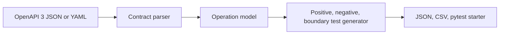
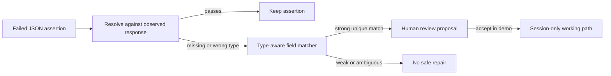

# Architecture

## Test generation flow

## Self-healing flow

## Guardrails

- Repairs are suggestions and require human acceptance.
- The offline matcher checks field name similarity, response context, and expected value type.
- Ambiguous or weak matches produce no suggested replacement.
- The app does not call live endpoints or modify test files.
- Optional LLM mode is isolated and validates that a proposed path exists in the observed response.

## Production evolution

Add schema reference resolution, authenticated API test execution, environment controls, secret management, response contract validation, baseline versioning, repair audit history, confidence calibration, and a pull request workflow for proposed changes. Keep a required reviewer and run the repaired test against a controlled environment before merging.

